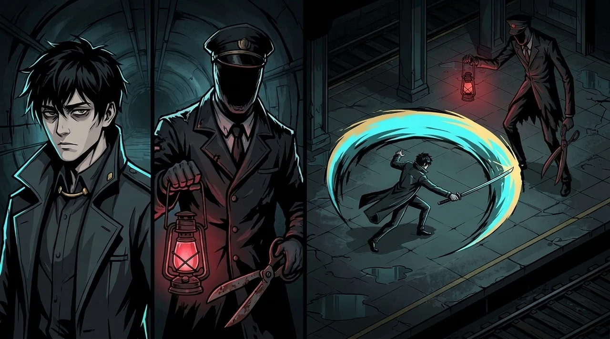
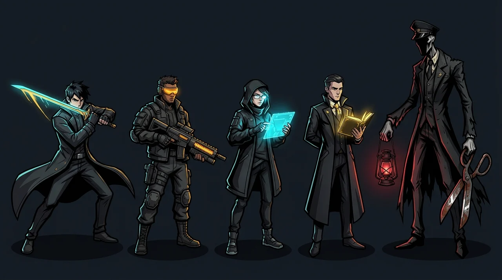
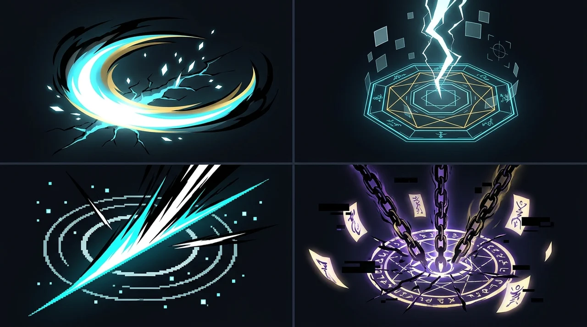
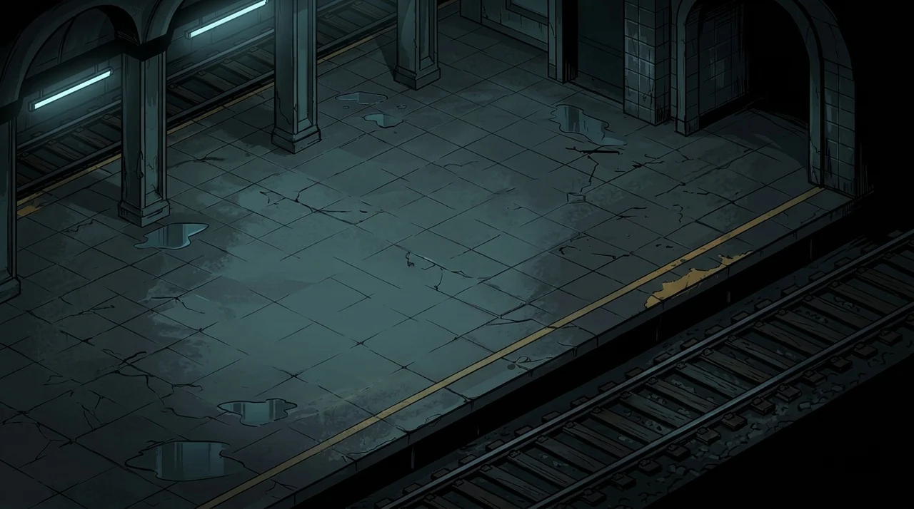
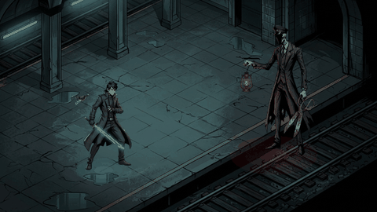
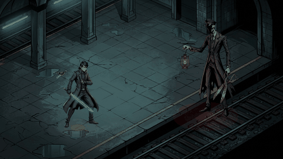

# Infinity 2.5D 美术与特效风格圣经（Art Bible v1.0）

> **状态**：已拍板视觉方向（2026-11-27）· 可供云端/后续会话直接接续设计与资产生产
> **适用范围**：`sim/`（大厅 UI / 无线电立绘 / 商店图标）及 `sim/world25d/`（2.5D 实时站台考场 / 角色 Sprite / VFX Flipbook / 场景融合）
> **前置代码基础**：P0（`8303aa0`，PostFX sRGB 色彩空间修复、唯一色源 `art_tokens.js`、暗调惊悚光照、武器切换、VFX 预算池）与 P1（`927c038`，程序化 SVG 图标、打击感与分档瞄准预览、6 区地标、`vfx_gallery.html`）均已合并至 `main`。

---

## 一、已拍板的核心视觉北极星

| 视觉层级 | 已拍板方向 | 商业标杆参考 | 核心视觉特征 |
|---|---|---|---|
| **整体画风与立绘** | **方案 1 · 怪谈重墨赛璐璐** | 《边狱巴士 Limbus Company》×《Hades》 | 锋利粗黑钢笔线稿、Mignola 式大面积死黑硬影切块、神经质冷酷生存质感、冷青/暖金/威胁红三色严控 |
| **2.5D 战场人物** | **阵容 A · 4.8 头身修长重墨硬影** | 《Limbus Company》×《Hades》 | 修长利落的成人比例、长风衣/战术轮廓、黑墨硬描边、单色边缘光；零号检票员采用畸变细长无面剪影制造视觉阶级差 |
| **技能特效流派** | **Hades 硬边赛璐璐（四流派左上）** | 《Hades》 | 弃用糊屏软渐变光球；采用 **极亮白芯 + 高饱和主色阶梯硬色带 + 死黑墨烟拖尾衬底 + 菱形硬边火星 + 1–2 帧黑白反色 Impact Frame** |

### 视觉锚点原件

#### 1. 整体画风概念板（方案 1）

#### 2. 战场人物全员风格锚点（阵容 A）
从左到右：主角剑修 / 陆烬（轨道枪）/ 许檀（黑客平板）/ 严辞（法典）/ 零号检票员（Boss）。

#### 3. 技能特效风格锚点（锁定左上象限：Hades 硬边赛璐璐）

#### 4. 场景舞台锚点（方案 1 零号站台）

---

## 二、实机 PoC 动图与关键问题复盘（下阶段必须解决的 4 条硬性铁律）

以下两张 PoC 动图使用真实绿幕角色动作表（[主角 4 帧](assets/sheet_hero_4frames.webp) / [检票员 3 帧](assets/sheet_boss_3frames.webp)）与 2×2 Hades VFX Flipbook（[青金剑气](assets/flipbook_hades_cyan.webp) / [紫金烈焰](assets/flipbook_hades_flame.webp)）合成，验证了画风与打击节奏（蓄力 → 残影 → 2 帧 Impact Frame → 击飞 → 地面裂纹）：

| 青金剑气弹反 PoC | 紫金诡焰重劈 PoC |
| :---: | :---: |
|  |  |

> **PoC 阶段暴露的 4 项关键工程与视觉问题（正式设计与实装前必须全部纠偏）**：

### 铁律 1：严格修正 2.5D 俯视视角下的人物与 Boss 比例（绝不照搬 PoC 的横版格斗尺寸）
- **问题**：PoC 动图中主角占视口高度约 **42%**、检票员占 **62%**，属于纯横版格斗游戏比例，在 2.5D 俯斜战术动作游戏中严重过大，导致移动空间局促、无法观察战场走位与队友阵型。
- **正式比例标准（写死到引擎与出图规范）**：
  - **相机俯角**：35°–45°（延续 `engine_25d.js` 俯斜视角）。
  - **普通人类角色（玩家 / 队友）**：**视口高度的 11%–15%**（Three.js 世界坐标高度约 `1.65m – 1.85m`，占地砖约 `1.5 – 1.8` 格）。
  - **零号检票员（Boss）**：**玩家身高的 1.45× – 1.65×**（视口高度 **18%–23%**，世界高度 `2.5m – 2.9m`）。压迫感来自**非人瘦长剪影比例 + 垂地破大衣 + 大范围暗红灯笼光染与地面阴影**，而非塞满半屏的巨人。

### 铁律 2：消除“场景 / 人物 / 特效 / 怪物各是各的”拼贴感
- **统一透视倾角（最核心）**：
  - PoC 中的角色动作表为 **0° 纯侧平视**，与 **35° 俯视站台** 存在视角割裂。
  - 后续正式生产的全部 2.5D 战场 Sprite 必须统一锁定 **25°–35° 俯斜四分之三视角（Three-quarter top-down 2.5D view）**，可见头顶、双肩顶面及前后脚在斜向地砖上的落点纵深。
- **统一场景光影吃色（Lighting Integration）**：
  - 正式接入 Three.js 的外部角色贴图严禁使用纯自发光贴片（`MeshBasicMaterial`）。
  - 必须走 **PBR `MeshStandardMaterial` + 自动推导切线空间 Normal Map + 严格局部 Emissive Map**（仅能量剑刃、目镜、终端屏、检票员红灯笼与眼窝发光，衣料与皮肤为 `0.06` 以下低自发光），让站台冷青荧光灯、玩家手电 `SpotLight` 和检票员红灯笼真实照亮角色明暗面。
- **双层接地阴影（Contact + Directional Shadow）**：
  - 每个角色与怪物脚底必须叠加：**① 紧贴鞋底、高浓度实黑的 Contact Shadow**（彻底消除“悬浮感”）；**② 随主光源/手电/灯笼方向偏转拉长的软边投影**。

### 铁律 3：规范特效与人物的空间比例及透视贴合
- **问题**：PoC 中 Hades 特效以 0° 屏幕正面贴图盖在画面上，且半径远大于角色，形成“巨型贴纸遮挡人物”的违和感。
- **正式特效空间规范**：
  - **地面层特效**（裂纹焦痕、八卦/诡目法阵、EMP 冲击波、烟尘底环）：**100% 压平渲染在 3D 地面 XZ 平面（`y = 0.04 ~ 0.08`）**，严格服从场景透视缩短与地砖比例。
  - **挥斩与爆发层特效**（剑气弧光、重劈波）：以 **倾斜 15°–35° 的 3D 弧面 / 对齐武器挥砍轨迹的 Flipbook Billboard** 渲染，实际显示半径严格绑定技能判定半径 `slot.radius`（近战挥斩约为角色身高的 **1.2× – 2.0×**），且通过分层深度（先绘背后暗墨烟 → 绘角色 → 绘刀锋前缘亮弧）确保**绝不糊死主角动作剪影**。
  - **颜色与语义铁律**：延续 `sim/data/art_tokens.js`，威胁红 `#ff1e36` 专供零号检票员与致命危险；玩家全系技能（含血咒/诡异）主色与威胁红保持 `>= 24°` 色相距。

### 铁律 4：强制怪物/角色与场景的物理碰撞及环境交互
- **问题**：PoC 中检票员受击后退悬空跨过了黄色站台警戒线与下沉轨道，与场景无物理耦合。
- **正式实机引擎交互规范**：
  - **硬边界约束**：角色与 Boss 的所有移动、冲刺与击退位移必须逐帧经过 `StationMap.resolveCircleWallCollision()` 与站台边缘/铁轨碰撞体（`rail_trench` 区域不可浮空穿越，除非专属跨轨技能）。
  - **撞墙/撞柱反馈**：击退命中墙体或承重柱时触发 **碰撞反弹 + 微顿帧（35ms）+ 混凝土碎屑火星粒子**。
  - **地面环境耦合**：
    - 踩过积水地砖（`puddle`）触发微弱冷青水花涟漪与水声；
    - 检票员拖行铁剪或大招落点在**可通行地砖范围内裁剪生成**持久化地面裂纹/焦痕 Decal（绝不悬空伸出站台边缘）。

---

## 三、云端续接设计 & 资产生产任务清单（Next Steps）

后续云端会话可直接按以下顺序推进设计与落地：

### Phase A · 视觉比例与透视定型（优先验证，1–2 张定标图）
1. **重出一张“2.5D 正确比例实机目标帧（Target Frame）”**：
   - 在方案 1 零号站台空景中，按 **玩家 13% 视口高 / Boss 21% 视口高**、**30° 俯斜角色透视**、**压平地面透视的 Hades 裂纹与贴合身高的剑气弧**、**清晰双层脚底接触影与站台安全线内对峙** 重新定标，作为后续全部工程调参的黄金标尺。
2. **用统一 30° 俯斜视角重出主角 & 检票员正式 Sprite Sheet**：
   - 主角：`idle / walk(2-4帧) / windup / slash / hit`（并按 `sword / cyber / occult / tactical` 区分武器握持剪影）。
   - 检票员：`idle / walk / lunge_telegraph / shear_strike / hit_recoil`。

### Phase B · 全员立绘与队友 Sprite 换血
1. **方案 1 重墨高精立绘批量重制**（替换 `sim/assets/portraits/*.webp` 现有的 32px 简陋头像）：
   - 覆盖全部 8 位角色 + 零号检票员（`yanci / lujin / xutan / shenyan / yelin / litianyang / guhe / inspector`，256×256 或 512×512 WebP）。
   - 统一构图规格：暗黑地铁隧道背景 + 方案 1 粗黑钢笔线稿 + 死黑硬影切块 + 角色专属 `ArtTokens.CHARACTERS` 单色侧逆光；核心角色预留 `calm / tense / injured` 情绪差分接口。
2. **补齐队友战场 Sprite Sheet**：陆烬、许檀、严辞、沈砚（统一 30° 俯斜 4.8 头身重墨风格 + 绿幕去溢抠图 + 脚底锚点锁死 + 自动推导 Normal/Emissive 贴图）。

### Phase C · Hades Flipbook 序列帧补全与 Three.js 引擎接入
1. **补齐核心技能 Hades Flipbook（2×2 或 4×2 纯黑底，保留暗墨烟 + 白芯硬边）**：
   - 已产出初版：`flipbook_hades_cyan.webp`（剑气斩）、`flipbook_hades_flame.webp`（烈焰/诡紫重劈）。
   - 待补充：`emp_lightning`（青白电弧+黑烟）、`tao_sigil_ground`（压平地面的重墨八卦/符阵）、`rail_beam_impact`（轨道炮穿刺爆裂）、`occult_chains`（重墨紫金锁链）、`aegis_heal_burst`（护盾/翡翠医疗波纹）。
2. **引擎改造（不破坏现有 12/12 机械守卫测试）**：
   - `sim/data/asset_manifest.js`：启用 `sprites` 与 `vfxFlipbooks` 清单，零 404 回退。
   - `sim/world25d/vfx_studio.js`：新增 3D 空间 Flipbook UV 帧播放器（区分地面 XZ 压平层与空间倾斜挥斩层）+ 暗墨烟/高亮双 Pass 混合。
   - `sim/world25d/engine_25d.js`：PostFX 新增 `uImpactInvert`（1–2 帧弹反/重击黑白高反差冲击帧通道）、角色世界缩放校准至 1.75m/2.75m 黄金比例、击退碰撞撞墙反馈与地面 Decal 边界裁剪。
