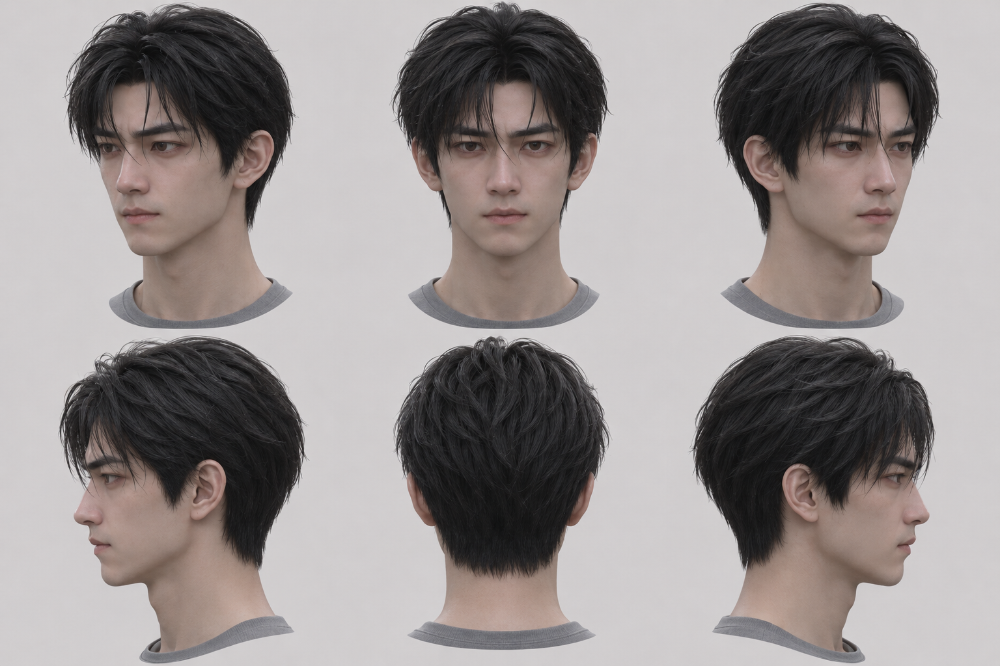

# 陆寻 · 开局四种出身多视图

四种出身共用一张脸和同一副身形。画新镜头时，把头部母版与当次所选职业的全身图一起作为参考。需要核对雨巷光线和动作时，再看对应的开局人像。

## 头部母版

以测绘版开局人像为面貌基准。看正面时对齐眉眼间距和偏分额发，看侧面时对齐鼻梁、下巴和耳位，转到背面时沿用母版的发旋、后脑轮廓和短发脚。

上排从左到右为朝画面左的斜面、正面、朝画面右的斜面。下排为朝画面左的纯侧面、后脑、朝画面右的纯侧面。

## 四种职业装

每张全身图从左到右都是正面、斜面、纯侧面、背面。中间两格的人物都朝画面右侧，便于叠看同角度的肩线、腰线和身高。下表的左右均按陆寻本人判断。

| 职业与全身转面 | 跨镜头要对上的细节 | 开局人像 |
| --- | --- | --- |
| [建筑／测绘毕业生](arch.webp) | 卡其翻领衫敞开，内搭灰 T 恤。左腕戴浅盘机械表，右手持黑壳黄钢卷尺。 | [雨巷测雾线](../../../game/assets/portraits/player_arch.webp) |
| [户外攀岩／体能教练](climb.webp) | 锈红衬衫卷袖，黑色双肩包在胸前扣合。浅米镁粉袋和收起的折刀同挂右髋，左腕露出圆表。 | [岩馆收工](../../../game/assets/portraits/player_climb.webp) |
| [历史／民俗档案馆实习生](archive.webp) | 深色圆领针织衫露浅灰衬衫领。挎带从右肩斜到左髋，右手持银色笔灯，左臂夹县志复印件，左腕有表。 | [县志与笔灯](../../../game/assets/portraits/player_archive.webp) |
| [社区急诊护工](medic.webp) | 炭灰拉链夹克里露出灰绿 V 领洗手衣。挎带经过左肩，急救包落在腰前，包口露绷带和碘伏棉片，右手拿手机。 | [夜班下班](../../../game/assets/portraits/player_medic.webp) |

身形以测绘全身图为比例基准。开局人像画幅以外的衣背、裤脚和鞋型由本套转面补定。图中是腕表绑定前的现实造型，进入绑定剧情后再在左腕加上哑黑色死考腕环。[第一场序幕设定](../01-白雾古宅-完整游戏设计案.md)
